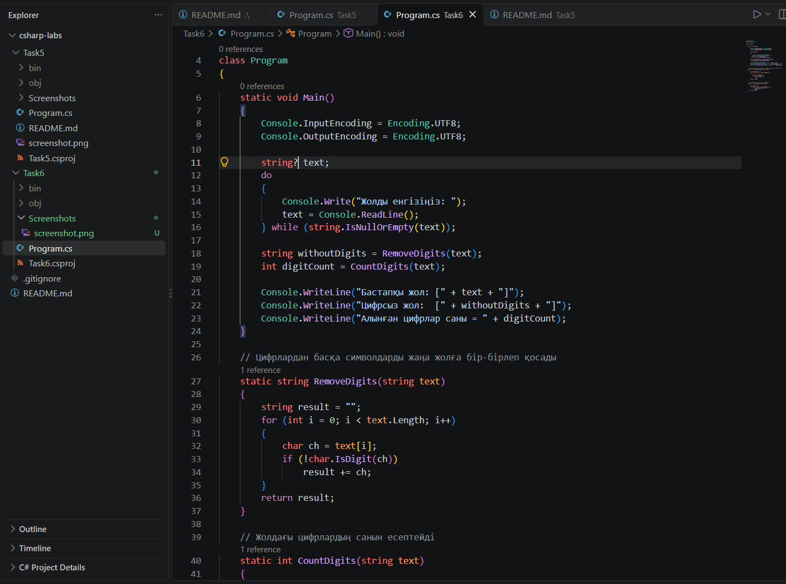

# 6-тапсырма: Символдар тіркесі (нұсқа 2)

Тапсырма: жолдағы цифрларды алып тастап, жаңа жолды және алынған цифрлар санын шығару.

| Тест | Кіріс | Қолмен есептеген жауап | Бағдарлама жауабы |
|---|---|---|---|
| Жеке тест | `   Әбдіманап ИС-21 тобында 2026 жылы   C# оқиды.    Lab 6 ОК   ` | Цифрлар: 2, 1, 2, 0, 2, 6, 6, барлығы 7 | 7 цифр алынды, жолда `ИС-`, `жылы` сөздерінің арасында бос орындар қалды |
| Өз тестім 1 | `Алма 5 кг, Нан 12 дана` | `Алма  кг, Нан  дана`, цифрлар саны 3 | 5, 1, 2 |
| Өз тестім 2 | `12345` | бос жол, цифрлар саны 5 | 1,2,3,4,5 |

## Сұрақтарға жауап

1) `text[i]` жолдың i-ші орнындағы символды қайтарады, оның типі `char`. Жолды C#-та өзгертуге болмайды (string өзгермейтін тип), сондықтан `text[i] = 'a';` деп жазсақ, компилятор қате береді. Символды алмастыру үшін жаңа жол құру керек.

2) Цифрды `char.IsDigit(ch)` арқылы тексердім. `'5'` бұл `char` типті символ (оның код мәні 53), ал `5` бұл `int` типті сан. Жолдың ішінде цифр сан емес, символ ретінде тұрады.

3) `result += ch;` орындалғанда жаңа жол жасалады, ескісі өзгермейді, себебі string өзгермейтін тип. Ескі жол қажет болмай қалса, жад тазалағышы оны жояды. Ұзын жолдарда мұндай қосу баяу болуы мүмкін, ондай кезде `StringBuilder` тиімдірек.

## Кездескен қате

Қате: `warning CS8600: Преобразование литерала, допускающего значение NULL или возможного значения NULL в тип, не допускающий значение NULL.`
Қалай түзеттім: `Console.ReadLine()` `null` қайтара алады, ал мен оны `string text` айнымалысына жазып отырдым. Айнымалыны `string? text` деп өзгерттім. Цикл `string.IsNullOrEmpty(text)` арқылы `null` мен бос жолды тексереді, сондықтан одан кейін ескерту шықпайды.
Түзеткен коммит: 1b3245f

## ЖИ қолдану

Claude-ке тапсырма PDF-ін жүктеп. Ол `RemoveDigits` және `CountDigits` әдістерінің кодын берді. `dotnet run` кезінде CS8600 ескертуі шыққанда, скриншотты көрсеттім, ол `string? text` деп өзгертуді ұсынды. Скриншот талаптары бойынша да кеңес алдым. Кодты өзім терминалда іске қостым, тесттерді өзім тексердім.